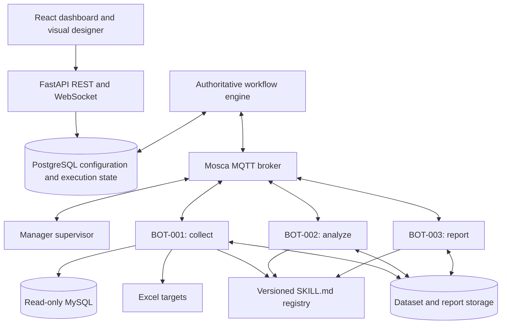

# AI Agent Manager

A runnable React/TypeScript + FastAPI multi-agent platform. Mosca is the MQTT broker. A separate workflow engine authorizes each staff execution; staff processes cannot publish downstream commands. PostgreSQL stores production metadata, shared storage holds datasets and reports, and MySQL supplies read-only manufacturing data. SQLite supports local development and tests.

## Start with Docker

Prerequisites: Docker Engine/Desktop with Compose, approximately 3 GB free disk space.

```powershell
python scripts/configure.py
docker compose up --build -d
docker compose ps
```

Open **http://localhost:8080**. In **Settings**, enter the `API_TOKEN` from `.env`, then select **Connect**. The frontend port binds to loopback by default. Put an authenticated HTTPS reverse proxy in front of it for remote access. Broker and database ports are internal to Compose.

The configuration script creates unique random local secrets without displaying them or overwriting an existing `.env`. Alternatively, copy `.env.example` to `.env` and replace every placeholder. Use URL-safe letters, numbers, underscore, and dash for secrets. The sample MySQL bootstrap explicitly restricts its reader password to those characters. Keep `.env` out of source control.

The first startup creates the eight versioned skill packages, four agent configurations, one workflow, a 20-row MySQL production table, and a real Excel target workbook. Tests and approvals begin as **UNTESTED**; the application never presents fabricated successful executions.

To add another BOT, create its configuration and pinned skill assignments in Agents, then start another instance of the generic runtime with its ID (`python -m app.runtime BOT-004`), or copy a staff service in Compose and change its command and heartbeat check. No new agent runtime code is required.

## First successful workflow

1. In **Data Sources**, test both connections.
2. In **Skills**, test each skill, then approve its version. Reader tests use actual sources; downstream skill tests explicitly use deterministic fixture datasets.
3. In **Test Center**, test the Manager and each staff BOT. Staff tests run over Mosca in their actual runtime processes. Inspect Execution History for the asynchronous result.
4. In **Workflow Designer**, validate, then **Test workflow**. This reads actual MySQL and Excel sources through all three workers.
5. After that test completes, select **Run workflow**. Production execution requires tested agents, enabled approved pinned skills, tested sources, online required agents, and a successful full workflow test.
6. Inspect the run to see skill outcomes, exact failures, dataset lineage, MQTT events, calculated metrics, and a downloadable self-contained HTML report.

The sample computes 20,000 input units, 19,210 good units, **96.05% yield**, and a **−1.95 percentage-point** gap against the 98% target. These formulas are deterministic skill configuration, not LLM-generated arithmetic.

Automate this acceptance sequence against the actual stack:

```powershell
$env:API_TOKEN = '<your configured API token>'
python scripts/acceptance.py
```

This script requires Python 3.10+ and uses only the standard library. It fails unless every source, skill, BOT, and workflow check passes.

## Architecture



`START → MANAGER → BOT-001 → BOT-002 → BOT-003 → FINAL`

| Component | Responsibility |
| --- | --- |
| `backend/app/models.py` | Configuration documents, runs, executions, events, datasets, lineage, audit, heartbeat |
| `backend/app/schemas.py` | Agent, workflow, and MQTT message validation |
| `backend/app/runtime.py` | Engine, manager, separate staff runtime, claims, retries, recovery |
| `backend/app/task.py` | Killable skill subprocess, schema checks, skill events |
| `backend/app/validation.py` | Graph, references, dependencies, schemas, tests, approval, heartbeat gates |
| `backend/app/skills.py` | Skill loader, allowlisted executors, data access, deterministic computation |
| `backend/app/main.py` | Management API, test API, monitoring, WebSocket, token authentication |
| `backend/skills/*/1.0.0/` | Immutable SKILL.md, schemas, references, test documentation |
| `frontend/src/` | Dashboard, editors, graph, test center, monitoring, history, settings |
| `mosca/` | Mosca 2.8.3 broker and topic authorization |
| `mysql/init.sh` | Manufacturing fixture and SELECT-only account |
| `scripts/acceptance.py` | Real-stack acceptance procedure |

Configuration and runtime code are separate. The database uses typed run/event/dataset tables and JSON configuration documents rather than a separate relational table for every UI field. Immutable run snapshots and append-only audit records preserve previous configuration values. There is one operator API token, not a multi-user account/RBAC system.

## Local development

Use **Python 3.12** and **Node 20 or 22**. Install dependencies:

```powershell
python -m venv .venv
.\.venv\Scripts\python -m pip install -r backend/requirements.lock
Set-Location frontend
npm ci
Set-Location ../mosca
npm ci --ignore-scripts
Set-Location ..
```

Configure the five `MYSQL_*` environment variables for an existing SELECT-only MySQL account. The local runtime uses SQLite unless `DATABASE_URL` is set. The sample target workbook is generated during initialization. Secrets are read from the environment; `.env` is loaded automatically by Docker Compose, not by Python local startup.

```powershell
./scripts/start-local.ps1 -Python "$PWD/.venv/Scripts/python.exe" -MqttPassword '<local broker password>' -ApiToken '<local API token>'
# In a second terminal:
Set-Location frontend
npm run dev
```

Open **http://localhost:5173**. Enter the same API token in Settings. Press Enter in the startup script to stop its processes. To run on another OS, launch these commands from `backend/` with the same environment:

```text
python -m app.seed
python -m uvicorn app.main:app --host 127.0.0.1 --port 8000
python -m app.runtime engine
python -m app.runtime manager
python -m app.runtime BOT-001
python -m app.runtime BOT-002
python -m app.runtime BOT-003
```

Run `node server.js` from `mosca/` with `MQTT_PASSWORD` set. Do not run duplicate service identities; the supported topology has one workflow engine and one runtime per agent ID.

## Validation

```powershell
Set-Location backend
../.venv/Scripts/python -m pytest -q
Set-Location ../frontend
npm run build
```

Real-broker integration (start Mosca first, then run from `backend/`):

```powershell
$env:MQTT_PASSWORD = '<local broker password>'
$env:PYTHONPATH = '.'
../.venv/Scripts/python tests/live_mqtt.py
```

That integration test starts separate engine, Manager, and three worker processes. It verifies the success pipeline and a real Excel failure that prevents downstream execution. **It uses a MySQL input fixture, so it does not verify the MySQL server or Docker deployment.** The full `scripts/acceptance.py` procedure verifies those against a running Compose stack.

See [VALIDATION.md](VALIDATION.md) for checks actually performed in the build environment. Docker must be validated on a machine where it is installed.

## Execution guarantees and boundaries

- Every run, message, and execution has a durable ID. Execution claims are conditional database updates. Duplicate START messages do not launch the same execution twice. Duplicate messages are recorded in audit logs.
- The engine accepts a terminal result only for the current run, agent, and latest attempt. Staff agents never advance a graph. Broker ACLs prevent staff publication to command topics.
- Commands waiting for a worker are republished. Persisted terminal results are replayed after restart. The broker uses memory storage; the database is the recovery authority.
- Skills run sequentially inside a subprocess with the agent timeout. A failed required skill aborts remaining skills and downstream nodes. A known terminal failure may retry according to policy. A lost or partitioned worker fails the run without automatically retrying uncertain in-flight work.
- Stop prevents downstream progression. Already-running read-only work may finish; its late result is ignored for workflow progression.
- Large tabular data lives in dataset files; MQTT carries references and small metadata. Messages are capped at 64 KiB. Reports display at most 1,000 table rows and 30 chart bars.
- Skill versions are pinned and package contents are immutable through the API. Uploading a new version creates an untested draft. Approve it after a successful test, assign the version, retest the BOT and workflow, then run. Rollback uses the same assignment flow to select an older approved version.
- The MySQL executor only constructs an approved parameterized SELECT template against allowlisted table identifiers. Arbitrary LLM SQL, writes, and unrestricted SQL entry are not exposed. The database user is separately restricted to SELECT. Connection/read/query timeouts and row limits are applied.
- Only `.xlsx` is enabled; no macros are executed. File paths remain inside the configured data root. Uploaded ZIP packages import only a validated declarative SKILL.md; included executables are not extracted or executed.
- Runtime skill types cover instruction, template, composite, API, database, connector, and script packages. Script packages select approved server handlers; arbitrary uploaded Python is not enabled. Composite children must be pinned, enabled, and approved, with cycle/depth protection. API readers require an HTTPS host explicitly listed in `ALLOWED_API_HOSTS`, public DNS addresses, and optional `API_SECRET_*` environment references. Redirects are disabled and responses are size-limited.
- The editor supports a **linear directed workflow**, matching the requested three-BOT vertical slice. Branching, parallel joins, distributed engine leader election, user accounts/RBAC, LLM providers, XLS, and the broader generic analysis operation catalog are future extensions.
- The Manager monitors all MQTT events and logs failures; it does not make workflow decisions or generate LLM explanations.

## Operations

```powershell
docker compose logs -f workflow-engine manager-agent staff-agent-1
docker compose logs -f mosca
docker compose restart staff-agent-2
docker compose down
```

`docker compose down` retains data volumes. Back up PostgreSQL and the dataset/skill volumes together. The application does not automatically delete execution history, audit logs, or datasets. The UI fetches the latest 100 runs and 500 events/logs; older records remain in storage.

Health endpoint: `/api/health`. OpenAPI: `/docs` (requires the configured token, so use an authenticated HTTP client or the generated OpenAPI schema through the proxy). WebSocket `/api/ws` accepts the token in its first JSON message rather than a URL query parameter.

Mosca is retained as explicitly requested. Its legacy dependency tree should stay on an isolated internal network. The `MessageBus` interface provides a replacement seam for a future broker; there is no silent Mosquitto fallback.
